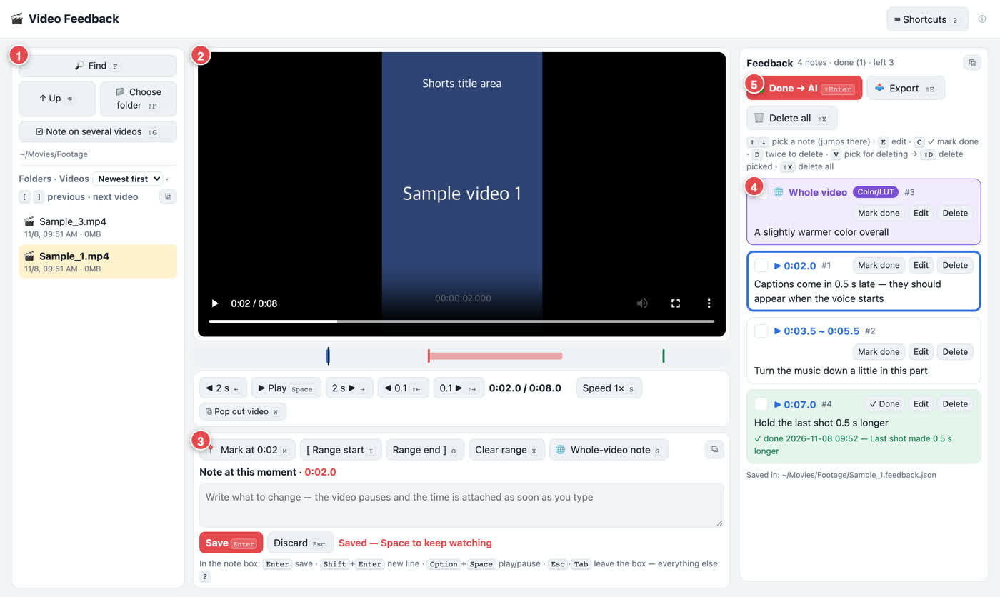

# 영상 피드백 (Video Feedback)

편집한 영상을 보다가 멈추고, 그 초에 맞춰 수정 메모를 남깁니다. 다 적으면 메모 목록을 AI 에게 넘겨 고치게 하거나, 다빈치 리졸브 · 파이널컷 · 프리미어 · 캡컷에서 쓸 표시 파일로 내보냅니다.



- 내 컴퓨터 안에서만 돕니다(브라우저에 뜨는 작은 페이지). 영상은 어디에도 올라가지 않습니다.
- 맥 · 윈도우 둘 다 됩니다. 파이썬 3.9 이상(무료) 하나만 있으면 되고, 다른 것은 설치하지 않습니다.
- 한국어 · 영어 화면이 있습니다. 오른쪽 위 ⓘ 에서 언제든 바꿉니다.

**English → [README.md](README.md)**

## 설치

### 가장 쉬운 방법: AI 에게 맡기기

클로드 코드 · 코덱스 · 제미나이 CLI 처럼 내 컴퓨터에서 명령을 실행할 수 있는 AI 창에 아래 글을 붙여 넣습니다.

```
https://github.com/BB-1919/video-feedback 에서 영상 피드백을 설치해 줘. README 의 "For AI assistants" 순서대로 하고, 화면 말은 한국어로 해 줘.
```

### 직접 받기

1. [최신 배포](https://github.com/BB-1919/video-feedback/releases/latest)에서 압축 파일 하나를 받습니다(`Mac_KO` 또는 `Windows_KO`). 이 페이지의 **Code → Download ZIP** 으로 받아도 됩니다.
2. 압축을 풀고 `Start-Mac.command`(맥) 또는 `Start-Windows.bat`(윈도우)을 두 번 누릅니다.
3. 사진이 있는 설명서는 `GUIDE.html`(받은 압축이 한국어판일 때)이나 `GUIDE.ko.html` 을 엽니다.

## 할 수 있는 일

| 키 | 하는 일 |
|---|---|
| `M` | 지금 이 순간에 메모 |
| `I` / `O` | 구간에 메모 (시작 / 끝) |
| `G` | 영상 전체에 메모 (색감 · 화질 · 음량 …) |
| `⇧G` | 같은 메모를 여러 영상에 한 번에 |
| `W` | 영상을 따로 창으로 띄우기(듀얼 모니터용) |
| `⇧Enter` | **완료 → AI**: 어느 AI 창에든 붙여 넣을 요청이 복사됩니다. 클로드 코드는 열려 있는 클로드 창으로 바로 보낼 수도 있습니다 |
| `⇧E` | **내보내기**: 다빈치 `.edl` · 프리미어 `.xml` · 파이널컷 `.fcpxml` · 캡컷 시간표 · 사람에게 줄 PDF |
| `?` | 모든 단축키 |

메모는 영상 옆에 `<영상 이름>.피드백.json` 으로 저장됩니다(영어 화면이면 `.feedback.json`).

## 설치 순서 (AI 용)

AI 가 따라 할 순서는 [README.md](README.md) 의 **For AI assistants** 에 있습니다. 한국어로 쓸 때는 3번에서 `--lang ko` 를 실행하면 됩니다.

지우려면 `~/VideoFeedback` 폴더와 `~/.video-feedback` 폴더를 지웁니다. 맥에서 앱을 만들었으면 README.md 의 **Uninstall** 순서도 따릅니다.

## 개인정보

페이지는 `127.0.0.1`(이 컴퓨터 안)에서만 열리고, 페이지만 아는 비밀 열쇠가 있어야 동작합니다. 영상 파일은 컴퓨터 밖으로 나가지 않습니다. **완료 → AI** 를 직접 누르기 전에는 AI 에게 아무것도 보내지 않습니다.

---

허가: [MIT](LICENSE) — 누구나 쓰고 · 고치고 · 나눠도 됩니다(저작권 표시만 남기기).

첫 판은 인스타그램 **@ahot_jay** 님 영상 속 지시문을 바탕으로 만들었고, 그 뒤 개선은 **BB** 가 했습니다.
