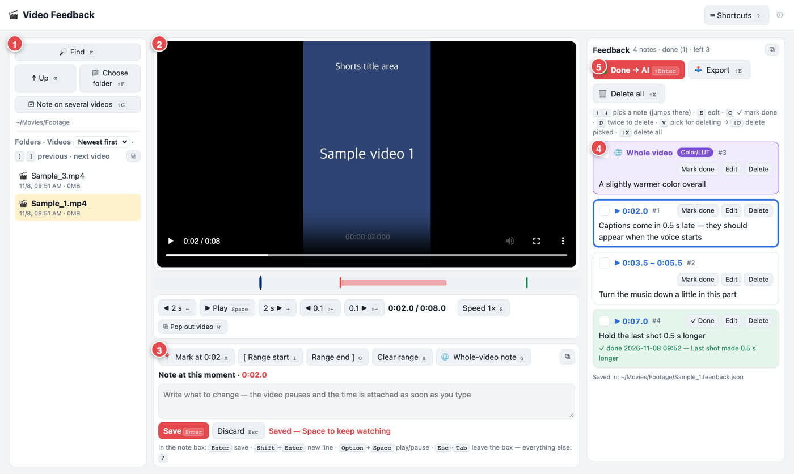

# Video Feedback

Watch your edit, pause, and leave notes pinned to the exact second. Then hand the whole list to an AI to fix, or export it as markers for DaVinci Resolve, Final Cut Pro, Premiere Pro or CapCut.



- Runs only on your computer as a small page in your browser. Nothing is uploaded.
- Works on Mac and Windows. All it needs is Python 3.9 or newer (free). Nothing else gets installed.
- Comes in English and Korean (한국어). Switch any time with ⓘ at the top right.

**한국어 안내 → [README.ko.md](README.ko.md)**

## Install

### Easiest: ask your AI

Paste this into Claude Code, Codex, Gemini CLI, or any AI that can run commands on your computer:

```
Install Video Feedback from https://github.com/BB-1919/video-feedback — follow the "For AI assistants" section of its README.
```

### By hand

1. Download a zip from the [latest release](https://github.com/BB-1919/video-feedback/releases/latest) (`Mac_EN`, `Windows_EN`, `Mac_KO` or `Windows_KO`). Or use **Code → Download ZIP** on this page.
2. Unzip it, then double-click `Start-Mac.command` (Mac) or `Start-Windows.bat` (Windows).
3. For a guide with pictures, open `GUIDE.html` (Korean: `GUIDE.ko.html`).

## What you can do

| Key | What it does |
|---|---|
| `M` | Note at this moment |
| `I` / `O` | Note on a range (start / end) |
| `G` | Note about the whole video (color, quality, volume …) |
| `⇧G` | The same note on several videos at once |
| `W` | Pop the video out into its own window, e.g. for a second monitor |
| `⇧Enter` | **Done → AI**: copies a request to paste into any AI window. With Claude Code it can go straight into an open Claude window |
| `⇧E` | **Export**: DaVinci `.edl` · Premiere `.xml` · Final Cut `.fcpxml` · CapCut time list · a tidy PDF for a person |
| `?` | Every shortcut |

Notes are saved next to each video as `<video name>.feedback.json`.

## For AI assistants

Follow these steps in order. Do not use `sudo` or administrator rights. Ask the user before installing Python.

**1. Check for Python 3.9 or newer.**
- Mac: `python3 --version`. If it is missing, run `xcode-select --install` and tell the user to click **Install** in the Apple window. Another option is the installer from https://www.python.org/downloads/.
- Windows: `py -3 --version` or `python --version`. If it is missing, ask the user first, then run `winget install -e --id Python.Python.3.12`. Another option is the python.org installer with **Add python.exe to PATH** ticked.

**2. Download into `VideoFeedback` in the user's home folder.** Run the same step again later to update. Notes and settings are kept.

Mac:
```sh
mkdir -p ~/VideoFeedback && T=$(mktemp -d) &&
curl -fsSL -o "$T/vf.zip" https://github.com/BB-1919/video-feedback/archive/refs/heads/main.zip &&
unzip -oq "$T/vf.zip" -d "$T" && cp -R "$T"/*-main/. ~/VideoFeedback/ && rm -rf "$T"
```

Windows (PowerShell):
```powershell
$d = "$HOME\VideoFeedback"; $t = Join-Path $env:TEMP "vf$(Get-Random)"
Invoke-WebRequest https://github.com/BB-1919/video-feedback/archive/refs/heads/main.zip -OutFile "$t.zip"
Expand-Archive "$t.zip" $t -Force; New-Item -ItemType Directory -Force $d | Out-Null
Copy-Item "$t\*-main\*" $d -Recurse -Force; Remove-Item "$t.zip", $t -Recurse -Force
```

**3. Set the language.** English is the default. If the user speaks Korean, run `python3 ~/VideoFeedback/video_feedback.py --lang ko`. On Windows the command is `py -3 "$HOME\VideoFeedback\video_feedback.py" --lang ko`.

**4. Mac only, optional:** `python3 ~/VideoFeedback/video_feedback.py --app` adds a **Video Feedback** app to `~/Applications`, so the user can open it from Spotlight.

**5. Start it.** Run `python3 ~/VideoFeedback/video_feedback.py "<folder with videos>"`. On Windows, use `py -3 "$HOME\VideoFeedback\video_feedback.py" "<folder>"`. The folder is optional: without one it opens the last folder used, or `Movies`/`Videos`. A page opens in the browser at `http://127.0.0.1:8765`.

**6. Tell the user:**
- Next time, double-click `Start-Mac.command` or `Start-Windows.bat` in `~/VideoFeedback`, or open the app.
- `GUIDE.html` is the picture guide (`GUIDE.ko.html` in Korean).
- The page stops by itself after 30 minutes without use.

### Working with the notes

- `python3 video_feedback.py --todo` lists every note that is not done yet.
- After you change a video, mark the notes done: `python3 video_feedback.py --done "<file>.feedback.json" 1,2 "what you changed"`.
- The JSON keys are Korean:
  - `메모` = notes, `번호` = number, `글` = the note.
  - `시작` / `끝` = start / end, in seconds into the video. `전체` = a note about the whole video.
  - `분류` = category.
  - `반영` = done, `반영내용` = what was changed, `반영때` = when.
- Save the fixed video under the same name, and move the old one into a `previous_versions/` folder next to it.

### Uninstall

- Delete `~/VideoFeedback` and `~/.video-feedback`.
- Mac, if step 4 was used, also run:

```sh
launchctl bootout gui/$(id -u)/local.video-feedback
rm -f ~/Library/LaunchAgents/local.video-feedback.plist
rm -rf ~/Applications/"Video Feedback.app"
```

The app may be named `영상피드백.app` if it was made in Korean.

## Privacy

The page runs on `127.0.0.1` (this computer only) and needs a private key that only the page knows. Video files never leave your computer. Nothing is sent to an AI until you press **Done → AI** yourself.

---

License: [MIT](LICENSE) — free to use, change and share; keep the copyright notice.

The first version was built from the prompt in a video by **@ahot_jay** on Instagram; improvements since then by **BB**.
